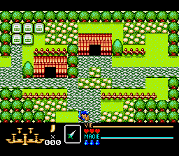

# Rendu incremental SGDK - 24 octobre 2026

Le moteur peut maintenant conserver une salle affichee et appliquer ses
changements, plutot que recharger512 tuiles et les768 mots de carte a chaque
presentation. SourceVdpDirty suit512 tuiles,768 mots,32 couleurs et la SAT.
Les suites contigues sont regroupees. Les clones de sprites sont regagnes
uniquement si leur tuile source ou leurs masques changent ; la SAT est actualisee
quand positions, liens ou selection changent. Les changements du masque gauche
et de la couleur de bordure sont pris en compte.

source_irq_video_publish alimente ce suivi lorsqu'une valeur du miroir change.
source_room_contours_marked offre le meme suivi aux ecritures du premier plan.
L'appelant partage l'objet de suivi entre producteurs, le garde vivant pendant
la presentation, puis le vide seulement apres un traitement reussi. La fonction
historique de contours reste disponible sans suivi.

L'API incremental exige une premiere publication complete reussie et le meme
mode de salle8x8, sans zoom, scroll materiel nul. Elle conserve l'etat d'affichage
et n'efface pas les indicateurs. L'appelant garde la possession du VDP et doit
planifier une fenetre de transfert suffisante : cette API ne garantit aucune
echeance de balayage. Les ecritures partiellement publiees ne doivent pas etre
rejouees comme si elles avaient ete annulees.

Validation :

-130 entrees par region,260 images MD PAL/NTSC : un chargement complet puis129
 mises a jour avec affichage actif. Tous les pixels256x192 concordent avec un
 oracle planaire independant et une calibration RGB565 par canal ; bandes noires
 verifiees. Le banc maintient chaque resultat avant capture.
-39 scenes du premier banc,28 images du vrai passage vertical3044..3071,
 60 images suivantes3101..3160 et3 cas identiques. Le passage comporte20
 modifications successives de carte (600 puis584..332 mots), avec R8/R9 nuls.
 Les60 dernieres images animent les sprites et n'ont pas de changements de carte.
-Compteurs des tuiles/mots effectivement envoyes controles. Les cas identiques
 envoient zero tuile, zero mot et zero clone.
-288 cas IRQ compares au Z80 original, puis576 executions68000 comparent
 VRAM/CRAM/registres et les indicateurs accumules. Toute difference finale doit
 etre couverte ; les ecritures intermediaires restaurees peuvent laisser des
 indicateurs supplementaires.
-64 cas directs de contours marques comparent VRAM/RAM/audio/temps/M1/R et la
 couverture des indicateurs.24 chaines source jusqu'a2002 et48 executions68000
 passent avec les producteurs actifs ; les indicateurs concordent aussi en68000.

Les images maintenues ne prouvent ni les pixels intermediaires d'une mise a jour,
ni sa duree, ni une tenue des60Hz. Les cas du nouveau chargeur conservent leurs
limites de provenance hors plages deja comparees a la source. Les anciens
rapports restent lies aux anciens SHA et aux archives correspondantes.

La ROM jouable reste v0275. L'integration naturelle, la cadence physique, les
scrolls materiels non nuls, l'origine globale et la campagne complete restent
ouverts. Aucun nouveau numero n'est attribue a une cartouche de diagnostic.

Animation des28 captures du banc, ralentie pour la demonstration. Elle ne
represente pas la cadence du jeu. Rapports : md_source_room_delta_report.json,
native_irq_video_dirty_report.json/native_irq_video_dirty_68k_report.json,
native_contours_dirty_unit_report.json et
native_room_contours_dirty_report.json/native_room_contours_dirty_68k_report.json.
