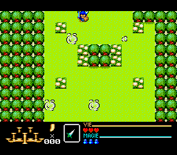

# Rendu SGDK des miroirs natifs - 24 octobre 2026

md_source_room_frame_upload affiche un miroir SMS complet sur le VDP Mega Drive.
Il convertit les512 tuiles par petits blocs, les768 mots de carte sur BG_A et
les couleurs de fond des pixels transparents sur BG_B. Deux palettes de fond
auxiliaires preservent les couleurs zero sans masquer les sprites. Les attributs
de palette, priorite et retournement sont conserves.

Les sprites viennent de la SAT3F00/3F80, puis source_sms_sprite8_prepare calcule
les masques par ligne et colonne. Les clones8x8 respectent les huit sprites SMS
par ligne, le decalage horizontal, le masque gauche et le bouclage vertical.
Le travail utilise un etat et de petits blocs de conversion plutot qu'une seconde
copie complete de toutes les tuiles MD en RAM.

Le contrat est volontairement explicite pour cette etape du raccordement : salle
immobile, name table3800, mode4/192, sprites8x8 sans zoom, scrolls nuls, H32/224,
plans64x32. L'appelant possede le VDP, desactive l'affichage pendant l'upload et
garde les buffers vivants. La fonction laisse l'affichage desactive.

Validation physique en emulation MD :39 scenes, chacune en PAL et NTSC, soit78
images. Chaque image256x192 est comparee a une reconstruction planaire SMS
independante, pixel par pixel, avec calibration RGB565 distincte par canal.
Les bandes16 lignes superieure/inferieure doivent rester noires.

-24 miroirs finaux de la chaine native de chargement et contours ; leurs octets
 non encore compares a une capture source gardent cette limite de provenance.
-3 captures VDP du jeu SMS original aux images3101/3120/3160 : tuiles, palette,
 carte et sprites reels. Leurs SHA sont lies au rapport et a la capture d'origine.
-12 scenes synthetiques : retournements/priorites/palettes,0/9/64 sprites,
 debordement, masquage gauche et decalage horizontal.

Toutes les images ont zero difference. Le code compile pour68000 effectue bien
les transferts SGDK, et le comparateur lit la sortie RGB du coeur MD.
Ce n'est pas encore une preuve de transition, de scrolling, de cadence par octet,
d'initialisation VDP globale, ni d'integration naturelle dans le jeu. Le moteur
jouable courant reste celui de la v0275. La cartouche de diagnostic n'est pas
une nouvelle ROM jouable numerotee.

Image de la scene provenant de la capture SMS3120, affichee par le nouveau
module sur le coeur Mega Drive NTSC. Rapport : md_source_room_frame_report.json.
